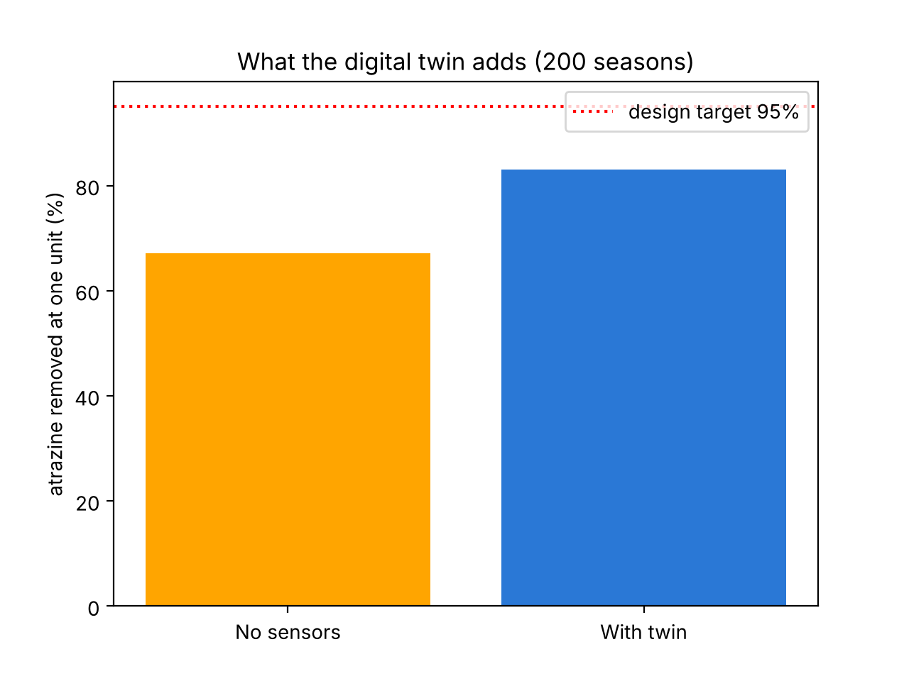

# Nephron · a digital twin for a farm-drain atrazine filter

Built for the **Waterloo Engineering Competition (Bio-Engineering, Nov 2026)**. The brief: cut herbicide contamination in the Châteauguay River watershed. Our two-person team designed **DC-BAS**, a filter at the outlet of a field's tile drain: a woodchip trench followed by a three-stage activated-carbon box.

**My part was the digital twin**: the sensor layout, a year-long visual simulation of the unit, and a Monte Carlo model of how much the sensors actually add.


## What it answers

A filter without sensors is run on a calendar (swap the carbon on a fixed day, let storms overflow). The twin watches flow and filter saturation and acts instead: it **holds water before a forecast storm**, **releases it slowly afterwards**, and **swaps the carbon when removal drops below 85%**.

| Over 200 simulated seasons | Removed at one unit | River load drop* |
|---|---|---|
| Calendar only (no sensors) | **67%** | 45% |
| With the digital twin | **83%** | 55% |

\* Assuming 95% of fields adopt it and tile drains carry 70% of the river's atrazine (2.0 kg/day at 38.6 m³/s, 0.6 µg/L).



The twin closes most of the gap but not all of it: neither version reaches the 95% design target, which points to sizing the carbon box up rather than more control logic.

## How the models work

- **`dcbas_sim.py`**: one growing season = 183 days. Rain is random (18% chance a day, gamma-distributed amounts); soil moisture turns rain into drain flow; atrazine spikes after spraying on day 45 and is washed out by flow. Removal chains the stages (woodchips 25%, carbon up to 90% falling as it saturates, polishing 50%). Flow above the unit's capacity (3.5 L/s) bypasses it untreated, which is where storms hurt. It runs 200 seeds with and without the twin and compares medians.
- **`cycle.py`**: the same unit over a full year as an animation: water and atrazine particles move along the treatment or bypass path, the three carbon stages fill up with colour, and the twin's panel shows its current instruction (raise boards, hold water, swap filter, bypass in winter).

## Run it

```bash
pip install -r requirements.txt
python dcbas_sim.py          # prints the table above, saves twin_benefit.png
python cycle.py stills       # six PNG frames of the year
python cycle.py              # full 365-day video (needs ffmpeg)
```

## Limits

Every coefficient (removal rates, carbon capacity, rain statistics) is a competition-day estimate, not a measurement, and the river numbers assume uniform adoption. The model is a tool for comparing operating strategies, not a prediction of real river concentrations.
