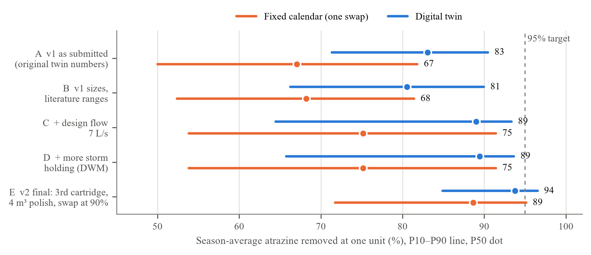
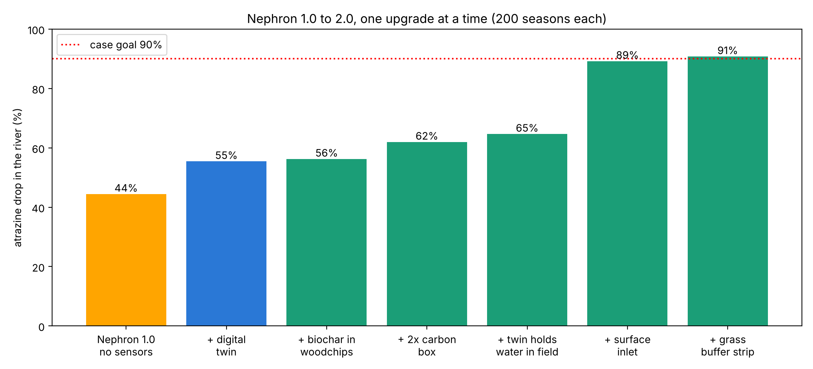

# NEPHRON · a digital-twin-managed bioreactor for atrazine in tile drainage

Built for the **Waterloo Engineering Competition (Bio-Engineering, Nov 2026)**, where it won **1st place**. The brief: cut herbicide contamination in the Châteauguay River watershed. Team: Thomas Kim (team captain) and Samuel Koo. NEPHRON (first called DC-BAS) sits at the outlet of a field's tile drain: a woodchip trench, then a carbon box with three wood-biochar cartridges and a granular activated carbon (GAC) polish, run by a digital twin.

**Samuel Koo built the digital twin**: the sensor layout, a year-long visual simulation of the unit, and the Monte Carlo season model in `dcbas_sim.py`.


## Results (revised report, v2)

**[Read the report: `report-v2/NEPHRON_Report_v2.pdf`](report-v2/NEPHRON_Report_v2.pdf)** · [what changed from the submitted version and why](report-v2/CHANGES.md)

The revised report sizes every stage for one design flow (7 L/s from a 20 ha field) and replaces single guesses with ranges taken from published studies. The twin's model is then re-run over 200 storm seasons. Results are the median (P50) with the 10th to 90th percentile in brackets.

| Final design, 200 seasons | P50 | P10 – P90 |
|---|---|---|
| Removal at the unit, fresh media, no bypass | **97%** | 94 – 99% |
| Removal at the unit, season average with the twin | **94%** | 85 – 97% |
| Removal at the unit, season average on a fixed calendar | 89% | 72 – 95% |
| River atrazine drop, NEPHRON alone (95% of fields) | **47%** | 34 – 65% |
| River atrazine drop, with buffer strips on surface runoff | **67%** | 55 – 77% |

Cost: about CAD 71,000 to install and **about CAD 750 per hectare per year** (500 – 1,050, depending on how often cartridges are swapped).

The submitted design reached 83% with the twin (67% on a calendar). Five changes, tested one at a time, close the gap: a 7 L/s design flow, more storm holding in the field, a third biochar cartridge, a 4 m³ polish, and swapping at 90% instead of 85%.



**Why the river number is lower than the unit number.** In a Quebec corn–soybean field, tile drains carried about half (47%) of the measured pesticide mass and surface runoff the rest. NEPHRON only treats tile water, so reaching the case goal of a 90% river drop also needs runoff controls and continued use reduction.

The full v2 model is in [`report-v2/`](report-v2/). It keeps the weather model from `dcbas_sim.py` unchanged, so the submitted design still reproduces 67% / 83%.

```bash
cd report-v2
python nephron_v2_sim.py figures              # 5 designs x 200 seasons, writes figures/v2_sim_results.json
python build_v2_figures.py figures figures    # redraws Figs. 2-5
```

## Nephron 2.0 and 2.5 (exploration, not yet checked against sources)

After the report, `dcbas_sim.py` was extended to test larger upgrades, including a surface inlet that sends ponded runoff into the unit. These runs give a higher river drop than the report, but rest on inputs the report could not back with sources, so the report numbers above are the ones we stand behind. The main differences:

| Input | Report v2 | Nephron 2.5 |
|---|---|---|
| Biochar capacity per season | 12 – 142 g (P50 41 g), from published Freundlich data, cut for organic-matter competition | 100 g per cartridge set, estimate |
| Share of atrazine in surface runoff | about 53% (Quebec field data) | 30% |
| Surface runoff reaching the unit | 0% (treated by buffer strips instead) | 90 – 95% via a surface inlet, estimate |
| Fields equipped | 95% | 98% |

| 2000 simulated seasons each | River atrazine drop (median) | Wet year (worst 10%) | Seasons over 90% |
|---|---|---|---|
| Nephron 1.0, calendar only (no sensors), 95% of fields | 43% | 29% | 0% |
| Nephron 1.0 with the digital twin, 95% of fields | 54% | 41% | 0% |
| Nephron 2.0 with the digital twin, 95% of fields | 91% | 87% | 71% |
| Nephron 2.5, 98% of fields | 95% (0.029 µg/L) | 93% | 97% |

Starting point: 2.0 kg/day of atrazine (0.6 µg/L at 38.6 m³/s). The case goal is a 90% drop.



### Nephron 2.0: what changed

Version 1.0 lost atrazine in three places: surface runoff that never reaches the tile drain (30%), storm water that overflows past the filter (7–16%), and a small leak through the filter (5–7%). Each upgrade targets one of them:

| Upgrade | Fixes | Model change |
|---|---|---|
| Biochar mixed into the woodchip bed | leak | woodchip stage 25% → 40% |
| Carbon box twice as big | leak + overflow | capacity 3.5 → 5 L/s, carbon ×2, longer contact time |
| Twin holds storm water in the field (controlled drainage) and swaps carbon at 93% | overflow | up to 60 units stored, released when flow is low |
| Surface inlet (riser + low berm) sends ponded runoff into the inlet box | runoff | 90% of surface runoff treated |
| Grass buffer strip for the rest | runoff | 50% of the remaining runoff removed |

The surface inlet is the biggest step: the filter can only clean water that reaches it.

### Nephron 2.5: making it hold in wet years

Version 2.0 passes 90% in a typical season but only 71% of seasons. 2.5 changes three settings, no new parts:

| Change | Why |
|---|---|
| Field storage 60 → 100 | Wet years overflow first; more held water protects the bad seasons |
| Twin swaps carbon at 96% instead of 93% | Less leak through a half-used cartridge |
| Better berm: 95% of surface runoff reaches the inlet | Less runoff escapes |
| Install on 98% of atrazine fields | Quebec requires an agronomist's prescription for atrazine, so the target fields are on record |

Coverage is the largest single lever: at 100% of fields the same design reaches about 98%.

## How the models work

- **`report-v2/nephron_v2_sim.py`**: the report's model. Same weather as below; adds one design flow for every stage, a biochar capacity from Freundlich isotherm data, a polish whose removal depends on contact time, a limit on how much storm water the soil can hold, and ranges for every uncertain input (Table IV of the report). Each design runs 200 seasons; results are P10 / P50 / P90.
- **`dcbas_sim.py`**: one growing season = 183 days. Rain is random (18% chance a day, gamma-distributed amounts); soil moisture turns rain into drain flow, and heavy rain (>12 mm) also makes surface runoff. Atrazine spikes after spraying on day 45 and is washed out by flow. Removal chains the stages (woodchips, carbon falling as it saturates, polishing 50%). Flow above the unit's capacity bypasses it untreated. Every gram is tracked into four buckets (runoff, bypass, leak, still stored at season end), and each design runs 2000 random seasons; the printed number is the median.
- **`cycle.py`**: the same unit over a full year as an animation: water and atrazine particles move along the treatment or bypass path, the three carbon stages fill up with colour, and the twin's panel shows its current instruction (raise boards, hold water, swap filter, bypass in winter).

## Run it

```bash
pip install -r requirements.txt
python dcbas_sim.py          # prints each upgrade step, saves nephron2_ladder.png
python cycle.py stills       # six PNG frames of the year
python cycle.py              # full 365-day video (needs ffmpeg)
```

## Limits

Every coefficient (removal rates, carbon capacity, rain statistics) is a competition-day estimate, not a measurement, the river numbers assume uniform adoption, and surface runoff is set to 30% of the load. The biochar, inlet-capture and buffer values are estimates to be checked against field studies. The model is a tool for comparing operating strategies, not a prediction of real river concentrations.
