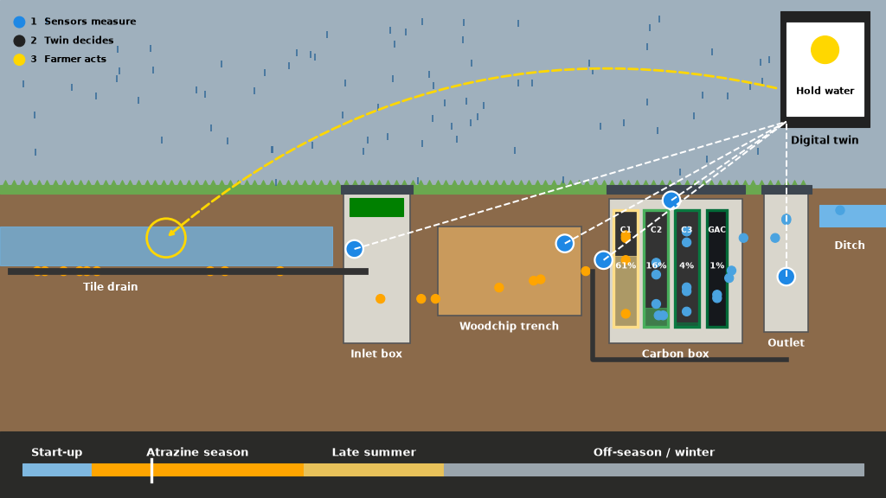

# Nephron · a digital twin for a farm-drain atrazine filter

Built for the **Waterloo Engineering Competition (Bio-Engineering, Nov 2026)**. The brief: cut herbicide contamination in the Châteauguay River watershed. Our two-person team designed **DC-BAS**, a filter at the outlet of a field's tile drain: a woodchip trench followed by a three-stage activated-carbon box.

**My part was the digital twin**: the sensor layout, a year-long visual simulation of the unit, and a Monte Carlo model of how much the sensors actually add.



## What it answers

A filter without sensors is run on a calendar (swap the carbon on a fixed day, let storms overflow). The twin watches flow and filter saturation and acts instead: it **holds water before a forecast storm**, **releases it slowly afterwards**, and **swaps the carbon when removal drops below 85%**.

| 2000 simulated seasons each | River atrazine drop (median) | Wet year (worst 10%) | Seasons over 90% |
|---|---|---|---|
| Nephron 1.0, calendar only (no sensors), 95% of fields | 43% | 29% | 0% |
| Nephron 1.0 with the digital twin, 95% of fields | 54% | 41% | 0% |
| Nephron 2.0 with the digital twin, 95% of fields | 91% | 87% | 71% |
| **Nephron 2.5, 98% of fields** | **95%** (0.029 µg/L) | **93%** | **97%** |

Starting point: 2.0 kg/day of atrazine (0.6 µg/L at 38.6 m³/s). The case goal is a 90% drop.


## Nephron 2.0: what changed

Version 1.0 lost atrazine in three places: surface runoff that never reaches the tile drain (30%), storm water that overflows past the filter (7–16%), and a small leak through the filter (5–7%). Each upgrade targets one of them:

| Upgrade | Fixes | Model change |
|---|---|---|
| Biochar mixed into the woodchip bed | leak | woodchip stage 25% → 40% |
| Carbon box twice as big | leak + overflow | capacity 3.5 → 5 L/s, carbon ×2, longer contact time |
| Twin holds storm water in the field (controlled drainage) and swaps carbon at 93% | overflow | up to 60 units stored, released when flow is low |
| Surface inlet (riser + low berm) sends ponded runoff into the inlet box | runoff | 90% of surface runoff treated |
| Grass buffer strip for the rest | runoff | 50% of the remaining runoff removed |

The surface inlet is the biggest step: the filter can only clean water that reaches it.

## Nephron 2.5: making it hold in wet years

Version 2.0 passes 90% in a typical season but only 71% of seasons. 2.5 changes three settings, no new parts:

| Change | Why |
|---|---|
| Field storage 60 → 100 | Wet years overflow first; more held water protects the bad seasons |
| Twin swaps carbon at 96% instead of 93% | Less leak through a half-used cartridge |
| Better berm: 95% of surface runoff reaches the inlet | Less runoff escapes |
| Install on 98% of atrazine fields | Quebec requires an agronomist's prescription for atrazine, so the target fields are on record |

Coverage is the largest single lever: at 100% of fields the same design reaches about 98%.

## How the models work

- **`dcbas_sim.py`**: one growing season = 183 days. Rain is random (18% chance a day, gamma-distributed amounts); soil moisture turns rain into drain flow, and heavy rain (>12 mm) also makes surface runoff. Atrazine spikes after spraying on day 45 and is washed out by flow. Removal chains the stages (woodchips, carbon falling as it saturates, polishing 50%). Flow above the unit's capacity bypasses it untreated. Every gram is tracked into four buckets (runoff, bypass, leak, still stored at season end), and each design runs 2000 random seasons; the printed number is the median.
- **`cycle.py`**: the same unit over a full year as an animation: water and atrazine particles move along the treatment or bypass path, the three carbon stages fill up with colour, and the twin's panel shows its current instruction (raise boards, hold water, swap filter, bypass in winter).

## Run it

```bash
pip install -r requirements.txt
python dcbas_sim.py          # prints each upgrade step, saves nephron2_ladder.png
python cycle.py stills       # six PNG frames of the year
python cycle.py              # full 365-day video (needs ffmpeg)
```

## Limits

Every coefficient (removal rates, carbon capacity, rain statistics) is a competition-day estimate, not a measurement, the river numbers assume uniform adoption, and surface runoff is set to 30% of the load. The biochar, inlet-capture and buffer values are estimates to be checked against field studies. The model is a tool for comparing operating strategies, not a prediction of real river concentrations.
